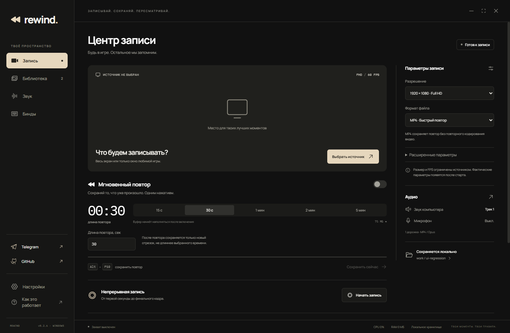

# REWIND

**Записывай. Сохраняй. Пересматривай.**

Приложение для Windows, которое сохраняет последние секунды игры по нажатию клавиши. Мгновенный повтор, непрерывная запись, отдельные аудиодорожки и редактор клипов — с локальным хранением, без аккаунта и облака.

[**Скачать установщик для Windows**](https://github.com/axolotllnd/rewind/releases/latest) · [Все версии](https://github.com/axolotllnd/rewind/releases) · [Telegram](https://t.me/axolotllnd) · [GitHub автора](https://github.com/axolotllnd)



*Интерфейс на тестовых данных. Тёмная и светлая темы используют тёплый бежевый акцент.*

## Что умеет

- Записывает весь экран или выбранное окно игры.
- Хранит скользящий буфер от **1 секунды до 30 минут** и сохраняет повтор по бинду.
- После сохранения следующий повтор содержит только новый промежуток, ограниченный длиной буфера.
- Поддерживает непрерывную запись, форматы **MP4, MKV и WebM**.
- Предлагает Full HD, 1440p, 4K и свои размеры; частоту кадров можно задать от **1 до 240 FPS**.
- Выбирает реальные входы и выходы Windows: наушники, колонки, микрофоны. До 8 источников и 6 дорожек; микрофон по умолчанию выключен.
- Показывает библиотеку с обложками, предпросмотром, переименованием и переходом между клипами.
- Обрезает видео, отключает или смешивает звук, меняет формат кадра, разрешение, FPS и битрейт при экспорте MP4.
- Работает в трее, поддерживает автозапуск и восстановление ранее включённого повтора.
- Показывает уведомления поверх окон, в том числе в демонстрации всего экрана. Есть настройка свечения и тихие звуковые сигналы.
- Поддерживает **русский и английский**, тёмную и светлую темы.
- Проверяет и скачивает обновления из GitHub прямо в настройках, устанавливает их с перезапуском; оттуда же можно открыть удаление приложения.

## Установка

1. Открой [последний релиз](https://github.com/axolotllnd/rewind/releases/latest).
2. Скачай `REWIND-0.2.13-Setup.exe` из раздела **Assets**.
3. Выбери язык, папку установки и нужные ярлыки. Установщик содержит все компоненты приложения.

Требуются **Windows 10 версии 2004 или новее, x64** и достаточно места для буфера и записей. Приложение и установщик пока без цифровой подписи.

Перед обновлением заверши запись и выбери **«Выход»** в трее REWIND. Настройки и библиотека установленной версии находятся в `%APPDATA%\REWIND`, клипы по умолчанию — в системной папке **«Видео»\REWIND**. Папку клипов можно изменить. Обновление и удаление приложения оставляют настройки и сохранённые записи.

Начиная с 0.2.9 обновиться можно через **Настройки → Обновления**: проверить, скачать, затем «Установить и перезапустить». REWIND проверит SHA-256 файла, дождётся сохранений и сохранит текущую непрерывную запись перед закрытием. Несохранённый буфер будет очищен. Проверка при запуске отключается; автоматического скачивания и установки нет. На версиях 0.2.8 и старее сначала установи текущую версию вручную. **Настройки → Удаление приложения** открывает штатный мастер Windows и оставляет пользовательские файлы на месте.

При первом запуске появляется необязательное предложение подписаться на канал и профиль автора. Его можно сразу закрыть крестиком, клавишей Esc или кнопкой «Начать пользоваться». Ссылки остаются в боковой панели.

## Первый повтор

1. Нажми **«Выбрать источник»** и выбери экран или окно.
2. До начала захвата настрой качество, формат и звук. Для быстрого сохранения выбирай **MP4**.
3. Укажи длину буфера и включи **«Мгновенный повтор»**.
4. Сохрани момент сочетанием **Alt + F10**.

| По умолчанию | Действие |
| --- | --- |
| Alt + F10 | Сохранить повтор |
| Alt + F9 | Начать / завершить непрерывную запись |
| Alt + Shift + F10 | Включить / выключить фоновый захват |

Если буфер равен двум минутам, а после предыдущего повтора прошло 30 секунд, сохранится новый отрезок длиной 30 секунд. Если прошло больше двух минут — последние две минуты. Неудачное сохранение не сдвигает границу.

Бинды внутри REWIND должны быть уникальны. Если сочетание занято другой программой, REWIND сохраняет выбранные клавиши и использует отдельный обработчик; другая программа тоже может реагировать.

## Что учитывать

- Разрешение и FPS — настройки захвата, а не обещание производительности. Результат зависит от источника, видеокарты, кодека и диска.
- Захват экрана H.264 использует Desktop Duplication + NVENC, когда они доступны; предусмотрен совместимый способ захвата.
- Если Windows показывает защищённое окно подтверждения (UAC), аппаратный захват ждёт возвращения обычного рабочего стола и восстанавливается автоматически. При повторном отказе применяется совместимый способ захвата того же монитора (до 60 FPS). Буфер и звук продолжают работать; само защищённое окно не записывается.
- Быстрый повтор MP4 сохраняет готовое видео без повторного кодирования. Точная обрезка MKV/WebM и экспорт могут занимать дольше.
- Демонстрация **всего экрана** включает плашку. Захват только одной игры или окна не включает посторонние окна автоматически. Для эксклюзивного полного экрана может потребоваться режим без рамок.
- Горячие клавиши страхуются несколькими обработчиками. Windows может ограничивать их приём в приложениях с более высокими правами; REWIND самостоятельно права не повышает. Работа в каждой повышенной игре не гарантируется.
- Выбранный системный выход содержит звук всех приложений, направленных в него. Чтобы разделить игру и чат, используй разные устройства/выходы и выбери их в REWIND.
- Не все видеоплееры одинаково поддерживают несколько дорожек и Opus в MP4. Для совместимого H.264/AAC-файла используй экспорт в редакторе.
- При обычной остановке несохранённый буфер удаляется. При сбое исходные фрагменты могут остаться для ручного восстановления; автоматического восстановления пока нет.

## Исходники и сборка

В репозитории находятся код, ресурсы, тесты и сценарии сборки. Зависимости, готовые установщики, личные настройки и записи в Git не включаются. Собственные Windows-помощники собираются из файлов `native/*.cs`; сторонний аудиодрайвер не требуется.

Нужны **Node.js 24 LTS** (не ниже 24.11) или Node.js 22.18+, **pnpm 11.25.0**, Windows .NET Framework C# compiler. Для установщика нужен [Inno Setup 6.7.4+](https://jrsoftware.org/isdl.php).

```powershell
git clone https://github.com/axolotllnd/rewind.git
cd rewind
pnpm install --frozen-lockfile
pnpm run build:native
pnpm run build:sounds
pnpm run build
pnpm start
```

Сборка единого установщика:

```powershell
pnpm run package
pnpm run installer
```

Результат: `outputs/REWIND-0.2.13-Setup.exe` и файл SHA-256. Если Inno Setup установлен нестандартно, задай полный путь к `ISCC.exe` в переменной `ISCC`.

`pnpm run test:code` запускает проверки без управления окнами. `pnpm test` включает дополнительные проверки записи, устройств и интерфейса, которые открывают тестовые окна и используют выходное аудиоустройство; микрофон не включается. `pnpm dev` запускает только предпросмотр интерфейса.

Подробнее: [руководство](docs/USAGE.md), [устройство проекта и сборка](docs/DEVELOPMENT.md), [история изменений](CHANGELOG.md), [сторонние компоненты](THIRD_PARTY.md).

## Обратная связь

Ошибки и предложения — через [GitHub Issues](https://github.com/axolotllnd/rewind/issues). Укажи версию REWIND и Windows, источник, формат и параметры записи. Перед публикацией логов проверь, что в них нет личных путей и названий окон.

Автор: [axolotllnd](https://github.com/axolotllnd). Новости: [t.me/axolotllnd](https://t.me/axolotllnd).

Авторский код опубликован без отдельной лицензии на повторное использование; см. [LICENSE](LICENSE). Сторонние компоненты сохраняют собственные лицензии, включая GPLv3 для поставляемого FFmpeg.
